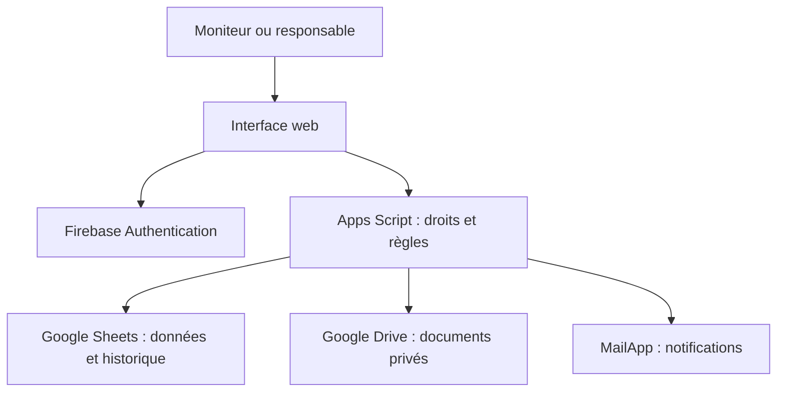

# AtoutSport Club Manager

**Un portail pour gérer l’équipe d’un club sportif : prestations, dossiers, documents et administration.**

Projet conçu et piloté par **Adam David Malila** ([ADMDM](https://github.com/ADMDM)), développé avec l’assistance de **ChatGPT / Codex** pour le code, les tests et la documentation.

Ce projet est né d’un besoin concret de gestion de moniteurs de natation. Cette édition publique rend son fonctionnement réutilisable par un autre club, avec ses propres comptes et ressources Google. Elle part de la base applicative 3.4 utilisée en novembre 2026, avec l’aide administrative et la correction directe des fiches par la direction. Sa numérotation publique commence à **1.0.0**.

**English:** An Apps Script portal for sports clubs: staff records, timesheets, review workflows, private documents and administration. Built and led by Adam David Malila with ChatGPT/Codex assistance. French interface and documentation; independent setup with your own Google and Firebase projects.

[Installation](docs/INSTALLATION.md) · [Guide utilisateur](docs/GUIDE_UTILISATEUR.md) · [Architecture](docs/ARCHITECTURE.md) · [Démarche et compétences](docs/DEMARCHE.md) · [Limites et validation](docs/VALIDATION.md)

## Ce que l’application permet

| Besoin | Fonctionnement fourni |
| --- | --- |
| Donner accès à l’équipe | Invitations personnelles, vérification de l’adresse email, rôles et désactivation des accès |
| Préparer les prestations | Planning piscine comme point de départ, saisie manuelle pour les autres activités, absences et remplacements |
| Transmettre une fiche | Brouillon, envoi mensuel, écarts à expliquer, heures prévisionnelles identifiées |
| Corriger une fiche | La direction demande une correction au moniteur **ou corrige elle-même**, avec motif et historique |
| Valider | Approbation distincte de la correction, réouverture motivée, contrôle des récupérations |
| Gérer un dossier | Coordonnées, identité administrative, horaires, tarifs, brouillons de contrat et documents privés |
| Suivre les paiements | Décomptes administratifs, clôtures et paiements déjà effectués ; aucun virement bancaire lancé |
| Accompagner les utilisateurs | Aide contextuelle et tour guidé dans les pages de gestion |
| Préparer l’affichage | Gestion des slides, messages et horaires destinés à un lecteur externe |

Le lecteur Raspberry Pi / TV est un composant séparé **non fourni dans ce dépôt**. Les fonctions de préparation de contenu sont incluses. La génération automatique de relevés PDF mensuels de la candidate 3.5 n’est pas incluse ; les contrats PDF et les documents personnels le sont.

## Essayer sans compte Google

Prérequis : Python 3 pour servir les fichiers localement.

```sh
python3 -m http.server 8000
```

Ouvrir **http://localhost:8000/demo/**. La démonstration utilise l’interface du portail avec des personnes fictives et un serveur simulé dans le navigateur. Les modifications disparaissent au rechargement, aucun email n’est envoyé. L’administration intégrée complète et la connexion réelle nécessitent l’installation Google.

- Vue direction : `/demo/?role=DIRECTOR`
- Vue moniteur : `/demo/?role=MONITOR`
- Vue activité hors piscine : `/demo/?role=MONITOR&person=manual`

## Technologies

| Couche | Outils et choix |
| --- | --- |
| Interface | HTML, CSS et JavaScript natif, mise en page adaptative, dialogues et aide contextuelle |
| Serveur | Google Apps Script, moteur V8, fonctions métier et contrôles des droits côté serveur |
| Authentification | Firebase Authentication, email / mot de passe et adresse vérifiée |
| Données | Google Sheets, lectures contrôlées et écritures groupées via l’API Sheets |
| Documents | Google Drive, fichiers privés et accès contrôlés par le portail |
| Notifications | MailApp, file d’attente et déclencheurs Apps Script |
| Vérification | Tests Node.js sans dépendance npm, services Google simulés |
| Construction | Python 3, sources modulaires assemblées dans `deploy/` |



## Installer dans son propre club

1. Télécharger le dépôt ou le cloner.
2. Créer ses projets Firebase et Apps Script.
3. Configurer les adresses de son installateur et de sa direction.
4. Installer les fichiers de `deploy/`, créer les tableaux privés et tester la connexion.
5. Activer les emails après vérification de ses destinataires.

Le [guide d’installation détaillé](docs/INSTALLATION.md) explique chaque étape. Aucun accès au club d’origine n’est nécessaire. Les tableaux et dossiers de départ sont créés par l’installateur ; aucune fiche réelle n’est distribuée.

## Développer et tester

Prérequis : **Node.js 22 ou supérieur**, **Python 3.10 ou supérieur**.

```sh
python3 scripts/build.py
node --test tests/*.test.cjs
python3 scripts/check_public.py
```

Aucun `npm install` n’est nécessaire. Le workflow GitHub Actions exécute ces contrôles sur les nouvelles contributions. Ces tests ne remplacent pas une recette dans un projet Google indépendant.

| Dossier | Rôle |
| --- | --- |
| `apps-script/` | Sources du serveur et des interfaces |
| `deploy/` | Cinq fichiers prêts à installer dans Apps Script |
| `scripts/` | Construction, contrôle de publication et maintenance temporaire |
| `tests/` | Scénarios métier, droits, stockage et interface avec données fictives |
| `demo/` | Démonstration locale, sans connexion à Google |
| `examples/` | Configuration d’exemple et schéma des tableaux d’affichage |
| `docs/` | Installation, usage, architecture, méthode et limites |

## Ce que ce projet illustre

L’analyse d’un besoin de terrain, sa traduction en parcours utilisateur, la modélisation de données, l’intégration de services Google, la gestion des rôles, les contrôles de cohérence, les tests de non-régression et la rédaction d’une documentation utilisable par une personne non technique.

La [démarche du projet](docs/DEMARCHE.md) précise la contribution humaine et l’assistance de l’IA, ainsi que les choix techniques et leurs compromis.

## Réutilisation

Code sous [licence MIT](LICENSE). Le nom AtoutSport décrit l’origine du projet et ne donne aucun droit d’usage de l’identité du club. Le logo d’origine et les signatures ont été remplacés ou retirés. Adapter les mentions, les modèles de documents et les règles de gestion à son organisation avant une utilisation réelle.

Les données du personnel, les exports Google, les identifiants de production et les liens du portail d’origine sont exclus. Voir [SECURITY.md](SECURITY.md) avant de publier une contribution.
