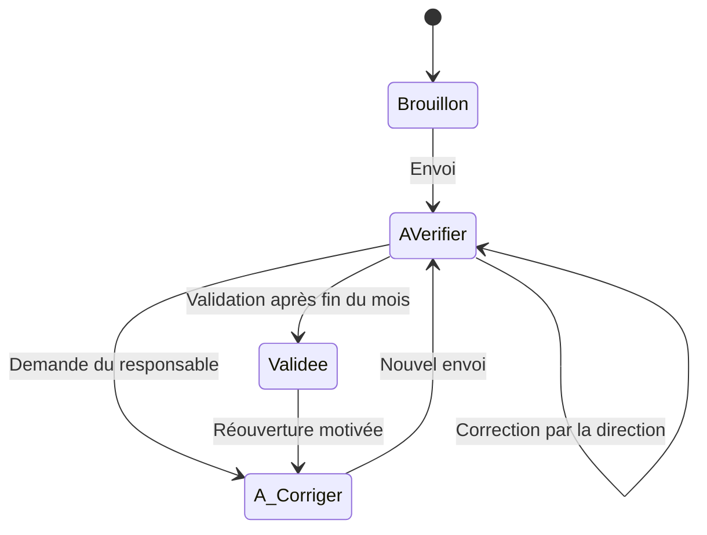

# Architecture et choix techniques

## Trois espaces de données

| Ressource | Contenu | Accès prévu |
| --- | --- | --- |
| `TV_BOOK_ID` | Planning, moniteurs nécessaires à l’affichage, slides, urgences et paramètres | Serveur ; lecteur externe limité à l’affichage si ajouté |
| `ADMIN_BOOK_ID` | Dossiers, activités, rémunérations, paiements, contrats, clôtures et journal | Administration autorisée |
| `PORTAL_BOOK_ID` | Comptes, fiches, récupérations, documents, file de courrier, identité, audit et historique | Serveur du portail |

Le portail utilise des lignes `ID` + `JSON` pour ses enregistrements versionnés. Les tableaux historiques de gestion gardent leurs colonnes métier. Les dossiers Google Drive contiennent les fichiers ; les tableaux stockent leurs références.

## Une requête authentifiée

1. Firebase connecte l’utilisateur et fournit un jeton.
2. L’interface envoie ce jeton à `portalRpc` avec une action et un contenu.
3. Le serveur contrôle le projet Firebase, l’expiration, l’identité vérifiée et la révocation. Décoder le JWT seul ne suffit pas : une vérification distante est effectuée.
4. Sous verrou Apps Script, le serveur retrouve le compte actif par UID et email, puis applique les droits de l’action.
5. La réponse ne contient que les informations nécessaires au parcours autorisé.

Le navigateur ne décide ni du rôle, ni du propriétaire de la fiche, ni du montant validé. La configuration Web Firebase est visible ; les autorisations sont contrôlées côté serveur.

## Fiches et historique

Une correction de direction modifie les lignes, incrémente la révision et conserve l’auteur de la correction, sa date et son motif. La fiche reste à vérifier. Les métadonnées de l’envoi original ne sont pas attribuées à la personne qui corrige.

`pCommit_` groupe la fiche, la version précédente et l’audit dans une requête Sheets `batchUpdate`. Le cache n’est mis à jour qu’après succès. Le verrou évite deux transactions simultanées ; la révision empêche une ancienne vue d’écraser une nouvelle modification.

## Modules

| Module | Responsabilité |
| --- | --- |
| `Auth.gs` | Identité Firebase, activation, invitations et droits |
| `Storage.gs` | Lecture, verrou, transaction, audit et historique |
| `Sources.gs` | Adaptation du planning et des données administratives |
| `Domain.gs` | Dates, plages horaires, minutes et règles de calcul |
| `Timesheets.gs` | Brouillons, envoi, contrôle, récupération et validation |
| `DirectorCorrection.gs` | Correction directe par la direction |
| `Profile.gs`, `Identity.gs` | Coordonnées et identité privée |
| `Documents.gs` | Catalogue, dépôt et téléchargement autorisé |
| `Mail.gs` | File de notifications, rappels et suivi d’envoi |
| `LegacyAdmin.gs` | Gestion administrative intégrée, contrats et contenu d’affichage |
| `Setup.gs` | Installation indépendante et activation des déclencheurs |
| `Main.gs` | Page Web et routage authentifié |

`LegacyAdmin.gs` contient encore un grand module historique encapsulé. Cette édition privilégie une base proche de l’application utilisée ; un découpage supplémentaire reste une amélioration possible. L’interface de correction et l’aide sont ajoutées sans reconstruire toute l’application.

## Emails et opérations incertaines

Les messages sont d’abord inscrits dans `OUTBOX`. Le service marque un envoi en cours avant d’appeler MailApp. Une interruption peut laisser un envoi au statut incertain : la reprise automatique ne doit pas envoyer silencieusement une deuxième copie. Une relance nécessite alors une vérification humaine.

Le calendrier de cette base utilise l’avant-dernier jour du mois comme échéance et des rappels sept, trois et un jours avant. La correction ordinaire est ouverte jusqu’au cinq du mois suivant, sauf règles de validation et retour explicite. Ce sont des choix métier adaptables, pas des obligations universelles.

## Compromis

Google Sheets rend les données accessibles à l’administration, mais impose des quotas, des limites de taille et des précautions de concurrence. Le projet convient à une structure limitée ; aucune capacité à grande échelle n’est revendiquée. Les tests utilisent des services simulés. Les droits Google, les emails, les quotas, le rendu sur appareil et la configuration Firebase exigent une recette réelle.
